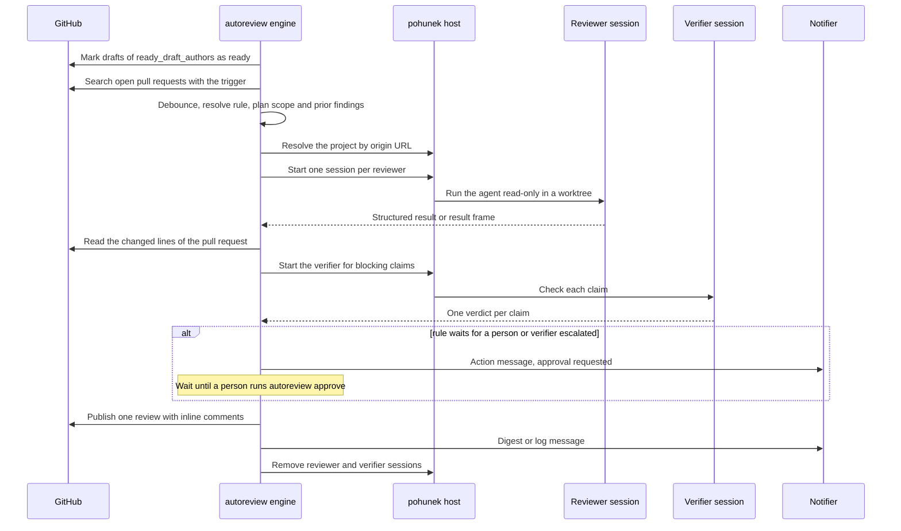

# How a review works

> **Status: planned for v0.1.** autoreview is not released yet. This page describes the design the first release implements; commands and keys may still change.

This page follows one pull request from the moment it asks for a review to the
moment its reviewer sessions are removed. Each step names the reference key
that controls it. The exact keys are in [policy.yaml](../../policy.md) and
[config.yaml](../../configuration.md).

## 1. Discovery

A discovery pass runs every `schedule.poll_interval_seconds` and on demand with
`autoreview poll`. Each pass does the following, in this order:

1. Marks the drafts of `ready_draft_authors` that request a review from the
   login of their repository's credential as ready for review. A failure here leaves the drafts for the
   next pass and holds up no review.
2. Searches open pull requests for every trigger the policy uses, each
   credential within its own `match`: `review-requested` (the pull request
   requests a review from the credential's login) or `label:<name>`. Label searches are limited to the owners and
   repositories of the rules that use that label.
3. Keeps a pull request as a candidate only when the trigger that found it is
   the trigger of the rule that matches its repository. Drafts are not
   candidates until they are ready for review.
4. Pages through search results with `schedule.search_page_limit` and
   `schedule.poll_limit`. A truncated search is an error, never a silent drop:
   a search that returns more than `schedule.poll_limit` fails with
   `github_search_limit_exceeded`.

A new head that arrives while a review is pending does not start a second
review at once. The scheduler waits `schedule.debounce_seconds` of quiet time
after the head it saw, so a burst of pushes is reviewed once.

A head that a published review already covers is not reviewed again. After a
notes hand-off, a renewed request for the same head adopts the stored result.

## 2. Rule resolution and copy at dispatch

The first rule in `repositories` whose `match` covers the repository decides
the pipeline, the trigger and the outcomes. A pull request that no rule matches is
never reviewed (`unmatched: skip`).

When a review is dispatched, the engine copies the resolved rule into the
stored review input. Later policy edits apply to the next review only; a review
in flight keeps the rule it started with. The author class (trusted or
untrusted) is resolved at the same moment and stored with the review. See
[untrusted authors](../safety/untrusted-authors.md).

The scope of the review (full or incremental) and its prior findings are also
decided at dispatch. See [incremental reviews](incremental-reviews.md).

## 3. Project routing on pohunek hosts

A review runs on a pohunek host, so the repository must be a registered pohunek
project there. At dispatch the engine asks every host in `pohunek.hosts` for its
project list and keeps the projects that:

- have the pull request's repository as their origin, compared in canonical form,
- come from one of the pipeline's `project_sources` (`manual`, `auto`, or both).

Exactly one match is required. None fails with `project_route_not_found`; more
than one fails with `project_route_ambiguous`, unless `pohunek.route_overrides`
pins the repository to one `{host, project_id}` pair. An override that matches
none of the candidates behaves as no match. Routing failures use their own retry
policy (see [state and recovery](state-and-recovery.md)). The route is stored in
the review input, so every session of the review goes to the same project.

## 4. Sessions per reviewer

Each reviewer of the pipeline runs in its own pohunek session, and the reviewers
run in parallel. The session is built from three parts:

- **Worktree base.** With `checkout: base` the worktree starts at the base branch
  tip, so repository guidance such as `AGENTS.md`, `CLAUDE.md` and `docs/` comes
  from trusted content. With `checkout: head` it starts at
  `refs/pull/<n>/head`, the pull request code itself.
- **Branch.** `<session.branch_prefix><workflow id>-<reviewer>-run<N>` and, for
  a second or later start attempt, `-start<M>`. Every start attempt gets its own
  branch. pohunek keeps the branch of a removed session, and an existing branch
  is checked out as it is, so a new attempt would otherwise begin from old
  state. The workflow id is a deterministic hash of the review identity and the
  attempt number.
- **Session name.** `<session.name_prefix>` followed by the same token as the
  branch. Names identify the engine's own sessions; a session with the same name
  owned by someone else is never touched.

Session start attempts happen inside the review: up to
`session.start_max_attempts`, waiting `session.start_retry_seconds` between them.
A start that the host may have accepted after the client timed out is found by
name before the next attempt is made.

Reviewer sessions never receive a GitHub token ([secrets](../safety/secrets.md)).

## 5. Result parsing and limits

Both protocols return one result contract: a summary, findings with their
blocking flag, the tests the reviewer ran, and one verdict per prior finding. The
protocol of the pipeline only decides how the result is produced (see
[reviewers and adapters](reviewers-and-adapters.md#protocols)). The engine reads
it with a fixed schema and checks it before anything is combined:

- The result must name the same repository, pull request number and head SHA as
  the review. A result about another head is rejected.
- The summary must be between `limits.min_summary_characters` and
  `limits.max_summary_characters` characters.
- At most `limits.max_findings` findings and `limits.max_tests` tests.
- Titles, bodies and paths stay within `limits.max_title_characters`,
  `limits.max_body_characters` and `limits.max_path_characters`.
- Paths must be relative and must not climb out of the repository.
- The result as a whole stays within `limits.result_max_bytes`.

Output that is incomplete, unusable or invalid gets a fresh session for that
reviewer, up to `session.reviewer_run_max_attempts`. Once the attempts are
spent, the review fails and the scheduler decides what happens next.

Finding ids combine the reviewer's `finding_prefix` with a three-digit sequence
number (for example `O001` for the first finding of the reviewer with prefix
`O`). Ids never collide across reviewers because the prefixes are unique.

## 6. Anchoring findings to changed lines

GitHub accepts an inline comment only on a line that the pull request changes on
the right-hand side of the diff. The engine reads those lines first, then
handles each finding:

| Where the finding points | Result |
|---|---|
| A changed line of the pull request | Anchored. Posted as an inline comment. |
| An unchanged line of a changed file | Moved to the closest changed line of that file. The body says where it was reported. Still blocking if it was blocking. |
| A file the pull request does not change | Not anchored and marked non-blocking. Listed in the review body, never holds the merge back. |

Anchoring runs before verification, so a finding in an unchanged file is a note
and is never sent to the verifier.

## 7. Verification

When the pipeline has a `verifier`, the engine sends it every blocking finding
and every prior finding that a reviewer called answered. The verifier gives one
verdict per claim, and a claim it cannot confirm becomes a note with its reason
in the body. Nothing is dropped. If the verifier fails, the claims stand as the
reviewers made them and the review is published with a line that says so.
Details and a worked escalation example are in [verification](verification.md).

Answered prior findings are checked again after verification. See
[incremental reviews](incremental-reviews.md#answered-on-auto-approve-rules).

## 8. Decision

The publication plan uses the blocking findings only. A review whose findings are
all notes, and that leaves no prior finding open, is clean. The order of the
rules is in [decisions](decisions.md#outcome-matrix). In short:

- Blocking findings: `request_changes` or `comment`, from `on_findings`.
- Clean: `approve`, `comment`, or a wait for a human (`await`), from `on_clean`.
- Clean with notes only: optionally a comment to the author first, from
  `on_notes`. See [notes hand-off](decisions.md#notes-hand-off).
- A pull request authored by the reviewing account always gets a comment.

## 9. Publication

The engine stores the final artifact and its publication plan before it posts
anything. That makes a resumed review publish the same content.

The review submitted to GitHub contains:

- The summary of each reviewer, with its label.
- The verification line, when a verifier ran.
- One inline comment per anchored finding.
- The notes, in a collapsed section. They get no inline comment, so they open
  no thread to resolve.
- The verdict on every prior finding, when the review has prior findings.
- The unanchored findings, listed in the body.
- The signature as the last line of the body and of every inline comment. The
  text comes from `publish.signature`, with `{login}` replaced by
  the login of the credential that serves the repository.
- A hidden marker, `<!-- autoreview:v1:<repo>#<n>@<head>:decision=...:findings=N:digest=... -->`,
  that names the publication, its decision and its number of blocking findings.
  The marker is also how a retry finds a review that was posted before its
  acknowledgement was lost, so the same review is never posted twice.

Model text is neutralized before it is rendered:

- `@mentions` do not notify anyone.
- Raw HTML is not rendered, and images are not embedded. GitHub fetches images
  on render, so an image would send a request to a host of the model's choosing.
- HTML comment delimiters are replaced, so model text cannot hide content or
  imitate the marker.
- Code fences are closed, so an unclosed fence cannot swallow the signature.

## 10. Notifications

Each event has a level (`action`, `digest` or `log`), and each level goes to the
backends in `notify.routes`. Delivery failures differ by level, see
[notifications](notifications.md). The hourly review queue is a separate message.

## 11. Cleanup

When a reviewer's output is stored, its session is removed. The engine retries
removal up to `session.cleanup_max_attempts`, waiting
`session.cleanup_retry_seconds` between attempts. A session that still cannot be
removed raises `cleanup_manual`, and someone removes it by hand with
`pohunek session rm`. Stored output is already safe, so the review continues.

Completed reviews are deleted after `store.review_retention_seconds`. Published
decisions are kept for `store.published_retention_seconds`, because the next
review of the same pull request uses them as its baseline. Leftover review
branches on the review hosts are removed by `autoreview prune-branches`. See
[stale sessions and branches](../runbooks/stale-sessions-and-branches.md).

## Where to go next

- [Reviewers and adapters](reviewers-and-adapters.md), [decisions](decisions.md),
  [incremental reviews](incremental-reviews.md) and [state and recovery](state-and-recovery.md).
- [Quickstart](../guides/quickstart.md) for a first run.
