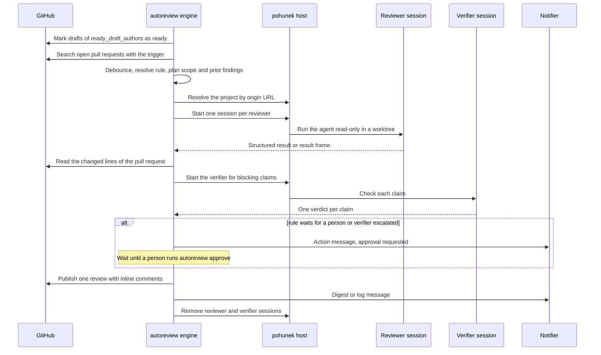

# How a review works

> **Status: 0.2.0.** This page describes autoreview 0.2.0. Parts
> marked planned or "not in v0.1" are not in 0.2.0.

This page follows one pull request from the moment it asks for a review to the
moment its reviewer sessions are removed. Each step names the reference key
that controls it. The exact keys are in [policy.yaml](../../policy.md) and
[config.yaml](../../configuration.md).

## 1. Discovery

A discovery pass runs every `schedule.poll_interval_seconds` and on demand with
`autoreview poll`. Each pass does the following, in this order:

1. Marks the drafts of `ready_draft_authors` that request a review from the
   login of their repository's credential as ready for review. A failure here leaves the drafts for the
   next pass and holds up no review.
2. Searches open pull requests for every trigger the policy uses, each
   credential within its own `match`: `review-requested` (the pull request
   requests a review from the credential's login) or `label:<name>`. Label searches are limited to the owners and
   repositories of the rules that use that label.
3. Keeps a pull request as a candidate only when the trigger that found it is
   the trigger of the rule that matches its repository. Drafts are not
   candidates until they are ready for review.
4. Pages through search results with `schedule.search_page_limit` and
   `schedule.poll_limit`. A truncated search is an error, never a silent drop:
   a search that returns more than `schedule.poll_limit` fails with
   `github_search_limit_exceeded`.

A new head that arrives while a review is pending does not start a second
review at once. The scheduler waits `schedule.debounce_seconds` of quiet time
after the head it saw, so a burst of pushes is reviewed once.

A head that a published review already covers is not reviewed again. After a
notes hand-off, a renewed request for the same head adopts the stored result. A
retarget to another base branch gets a full review of the same head (see
[incremental reviews](incremental-reviews.md#full-or-incremental)).

## 2. Rule resolution and copy at dispatch

The first rule in `repositories` whose `match` covers the repository decides
the pipeline, the trigger and the outcomes. A pull request that no rule matches is
never reviewed (`unmatched: skip`).

When a review is dispatched, the engine copies the resolved rule into the
stored review input. Later policy edits apply to the next review only; a review
in flight keeps the rule it started with. The author class (trusted or
untrusted) is resolved at the same moment and stored with the review. See
[untrusted authors](../safety/untrusted-authors.md).

The scope of the review (full or incremental) and its prior findings are also
decided at dispatch. See [incremental reviews](incremental-reviews.md).

## 3. Project routing on pohunek hosts

A review runs on a pohunek host, so the repository must be a registered pohunek
project there. At dispatch the engine asks the hosts of `pohunek.hosts` in order
for their project lists. A project matches when it:

- has the pull request's repository as its origin, compared in canonical form,
- comes from one of the pipeline's `project_sources` (`manual`, `auto`, or both).

The first host with a match runs the review, and the later hosts are not asked.
A host that fails is skipped with the warning `review host skipped` (host, code)
and is not asked again in the same discovery pass. Two matches on one host fail
with `project_route_ambiguous`. No match on any host fails with
`project_route_not_found`. When a host failed and no other host has the
repository, the review waits for a review host: it stays due, uses no retry of
[`schedule.retry_delays_seconds`](../../configuration.md#schedule), and starts on
the first discovery pass after a host answers (see
[waiting for a review host](state-and-recovery.md#waiting-for-a-review-host)).
With [`pohunek.host_state`](../../configuration.md#pohunekhost_state), only the
hosts whose state the rules allow are asked, idle hosts first if configured;
when only a held-back host has the repository, the review waits for a review host
with `host_state_ineligible`.
`pohunek.route_overrides` pins the repository to one `{host, project_id}` pair:
only that host is asked, and an override that matches none of its projects
behaves as no match. The two route errors fail through the scheduler and end
`failed`, because they are not retried. The route is
stored in the review input, so every session of the review, also after a
restart, goes to the same host and project; a retry is a new attempt and routes
again.

## 4. Sessions per reviewer

Each reviewer of the pipeline runs in its own pohunek session, and the reviewers
run in parallel. The session is built from three parts:

- **Worktree base.** With `checkout: base` the worktree starts at the base branch
  tip, so repository guidance such as `AGENTS.md`, `CLAUDE.md` and `docs/` comes
  from trusted content. With `checkout: head` it starts at
  `refs/pull/<n>/head`, the pull request code itself.
- **Branch.** `<session.branch_prefix><workflow id>-<reviewer>-run<N>` and, for
  a second or later start attempt, `-start<M>`. Every start attempt gets its own
  branch. pohunek keeps the branch of a removed session, and an existing branch
  is checked out as it is, so a new attempt would otherwise begin from old
  state. The workflow id is a deterministic hash of the review identity and the
  attempt number.
- **Session name.** `<session.name_prefix>` followed by the same token as the
  branch. Names identify the engine's own sessions; a session with the same name
  owned by someone else is never touched.

Session start attempts happen inside the review: up to
`session.start_max_attempts`, waiting `session.start_retry_seconds` between them.
A start that the host may have accepted after the client timed out is found by
name before the next attempt is made.

Reviewer sessions never receive a GitHub token ([secrets](../safety/secrets.md)).

## 5. Result parsing and limits

Both protocols return a summary, findings, the tests the reviewer ran, the
blocking flag of each finding and one verdict per prior finding (see
[reviewers and adapters](reviewers-and-adapters.md#protocols)). The engine reads
it with a fixed schema and checks it before anything is combined:

- The result must name the same repository, pull request number and head SHA as
  the review. A result about another head is rejected.
- The summary must be between `limits.min_summary_characters` and
  `limits.max_summary_characters` characters.
- At most `limits.max_findings` findings and `limits.max_tests` tests.
- Titles, bodies and paths stay within `limits.max_title_characters`,
  `limits.max_body_characters` and `limits.max_path_characters`.
- Paths must be relative and must not climb out of the repository.
- The result as a whole stays within `limits.result_max_bytes`.

Every reviewer request states the summary, title and body limits, and a Claude
request also the limit of each prior-finding note, so the reviewer knows them
before it writes.

A reviewer run that ends in `review_output_incomplete` (an empty output),
`review_wrapper_invalid`, `review_result_invalid` or `review_output_invalid`
(a check of this list) gets a fresh session, up to
`session.reviewer_run_max_attempts`. When the engine's output check refused the
run (`review_output_invalid`), the request of the fresh run says so in one
fixed sentence after the limits. Once the attempts are spent, the review fails
and the scheduler decides what happens next. A Claude Code result message that
cannot be used (`claude_result_invalid`) or whose prose disagrees with its
structured output (`claude_result_mismatch`), an output over
`session.output_max_bytes` (`review_output_too_large`) and an unusable answer
of the review host to a read of the session output end the review at once,
without a fresh session (see
[troubleshooting](../runbooks/troubleshooting.md#reviewer-output)).

Finding ids combine the reviewer's `finding_prefix` with a three-digit sequence
number (for example `O001` for the first finding of the reviewer with prefix
`O`). Ids never collide across reviewers because the prefixes are unique.

When two reviewers report a finding on the same path, line and severity, the
engine merges them into one finding. It keeps the id of the first reviewer in the
pipeline, the higher confidence and the longer body with its title, and it names
every reviewer that reported it. Findings of one reviewer are never merged with
each other.

## 6. Anchoring findings to changed lines

GitHub accepts an inline comment only on a line that the pull request changes on
the right-hand side of the diff. The engine reads those lines first, then
handles each finding:

| Where the finding points | Result |
|---|---|
| A changed line of the pull request | Anchored. Posted as an inline comment. |
| An unchanged line of a changed file | A blocking finding moves to the closest changed line of that file, and its body says where it was reported. A note keeps the line the reviewer reported. |
| A file the pull request does not change | Not anchored and marked non-blocking. Listed in the review body, never holds the merge back. |

Anchoring runs before verification, so a finding in an unchanged file is a note
and is never sent to the verifier.

## 7. Verification

When the pipeline has a `verifier`, the engine sends it every blocking finding
and every prior finding that a reviewer called answered. The verifier gives one
verdict per claim, and a claim it cannot confirm becomes a note with its reason
in the body. Nothing is dropped. If the verifier fails, the claims stand as the
reviewers made them and the review is published with a line that says so.
Details and a worked escalation example are in [verification](verification.md).

Answered prior findings are checked again after verification. See
[incremental reviews](incremental-reviews.md#answered-on-auto-approve-rules).

## 8. Decision

The publication plan uses the blocking findings only. A review whose findings are
all notes, and that leaves no prior finding open, is clean. The order of the
rules is in [decisions](decisions.md#outcome-matrix). In short:

- Blocking findings: `request_changes` or `comment`, from `on_findings`.
- Clean: `approve`, `comment`, or a wait for a human (`await`), from `on_clean`.
- Clean with notes only: optionally a comment to the author first, from
  `on_notes`. See [notes hand-off](decisions.md#notes-hand-off).
- A pull request authored by the reviewing account always gets a comment.

## 9. Publication

The engine stores the final artifact and its publication plan before it posts
anything. That makes a resumed review publish the same content.

The review submitted to GitHub contains:

- One summary, that of the first reviewer in the pipeline, with its label.
- The verification line, when a verifier ran.
- One inline comment per anchored finding.
- The notes, in a collapsed section, each with its heading and `path:line`. A
  note the verifier demoted also keeps its body, which carries the reason. Notes
  get no inline comment, so they open no thread to resolve.
- The verdict on every prior finding, when the review has prior findings.
- The unanchored findings, listed in the body.
- The validation the reviewers performed, in a collapsed section.
- The signature as the last line of the body and of every inline comment. The
  text is `publish.signature` as written.
- A hidden marker, `<!-- autoreview:v1:<repo>#<n>@<head>:decision=...:findings=N:digest=... -->`,
  that names the publication, its decision and its number of blocking findings.
  The marker is also how a retry finds a review that was posted before its
  acknowledgement was lost, so the same review is never posted twice. A second
  hidden marker right after it carries the SHA-256 digest of the base branch, so
  a review of the same head for another base branch is never taken for it. A
  review that GitHub dismissed is never reused; the review is posted again.

Model text is neutralized before it is rendered:

- `@mentions` do not notify anyone.
- Raw HTML is not rendered, and images are not embedded. GitHub fetches images
  on render, so an image would send a request to a host of the model's choosing.
- HTML comment delimiters are replaced, so model text cannot hide content or
  imitate the marker.
- Model text is defused wherever GitHub might read it as text, whatever GitHub
  decides about code. A fenced block in a summary, finding body or note is
  written again with the engine's own fence between blank lines, so GitHub
  reads it as code. An inline code span is kept only when its content is
  harmless as text (no `@`, `<`, `![` or HTML entity); every other backtick,
  and a run of three tildes, is escaped. Titles, tests and the other one-line
  fields keep no code. HTML entities are shown as written, and footnote
  syntax is escaped, so no model text renders after the signature. A reference
  to an issue, pull request or discussion of another repository
  (`owner/repo#12`, `owner/repo/issues/12`, or a GitHub URL to it) and a commit
  reference `owner/repo@sha` get a zero-width space, so GitHub neither links
  them nor records them in that repository; `#12` and `GH-12` stay references
  to the reviewed repository. A link reference definition is escaped, so it
  cannot turn engine text such as a login into a link. A fenced
  block in a language that GitHub renders in a viewer (`mermaid`, `math`,
  `geojson`, `topojson`, `stl`) is shown as plain code. The path and line of a
  finding are a code span in a paragraph of their own, with each bidi control
  or zero-width character shown as `<U+XXXX>`. Model text, code included, and a
  finding path in a notification show these characters the same way; only the
  zero-width spaces that the engine inserts stay invisible.
- Code fences are closed, so an unclosed fence cannot swallow the signature.

## 10. Notifications

Each event has a level (`action`, `digest` or `log`), and each level goes to the
backends in `notify.routes`; an event with its own key there goes to that route
instead. A message that cannot be delivered is dropped with a
warning, see [notifications](notifications.md). The hourly review queue is a separate message.

## 11. Cleanup

When a reviewer's output is stored, its session is removed. The engine retries
removal up to `session.cleanup_max_attempts`, waiting
`session.cleanup_retry_seconds` between attempts. A session that still cannot be
removed raises `cleanup_manual`, and someone removes it by hand with
`pohunek session rm`. Stored output is already safe, so the review continues.

Completed reviews are deleted after `store.review_retention_seconds`. Published
decisions are kept for `store.published_retention_seconds`, because the next
review of the same pull request uses them as its baseline. Review branches
stay on the review hosts after their sessions are removed. See
[stale sessions and branches](../runbooks/stale-sessions-and-branches.md).

## Where to go next

- [Reviewers and adapters](reviewers-and-adapters.md), [decisions](decisions.md),
  [incremental reviews](incremental-reviews.md) and [state and recovery](state-and-recovery.md).
- [Quickstart](../guides/quickstart.md) for a first run.
